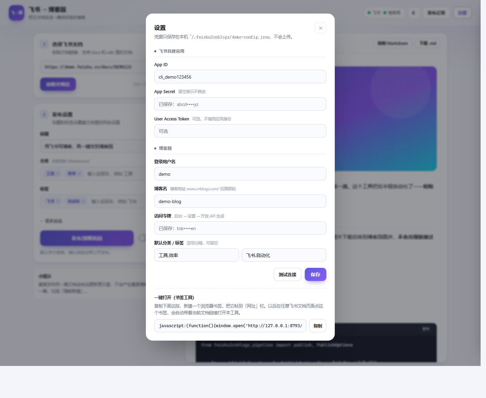

# feishu2cnblogs

把**飞书云文档**（新版 docx，含知识库 wiki 里的文档）转换并发布到**博客园**。

两种用法，同一套内核：

- **网页版**（推荐）：浏览器里粘贴链接 → 实时预览 → 一键发布，带进度条和发布记录
- **命令行**：适合脚本、批量、定时任务

零依赖：只用 Python 标准库（Python 3.8+，已在 3.10 验证），**不需要 pip 装任何东西**。


---

## 1. 30 秒上手

```bash
python run.py          # 不带参数 = 直接打开网页版
```

或者双击 `web.cmd`。

第一次打开会提示还没配置凭据，点右上角 **设置** 填三组信息：

| 需要的值 | 从哪来 |
| --- | --- |
| 飞书 App ID / App Secret | [飞书开放平台](https://open.feishu.cn/app) → 创建企业自建应用 → 凭证与基础信息 |
| 博客园 登录用户名 / 博客名 | 用户名是**登录名**；博客名是博客地址 `www.cnblogs.com/` 后面那段 |
| 博客园 访问令牌 | 博客园后台 → 设置 → **开放 API** → 生成令牌（不是登录密码） |

填完点「测试连接」，两个绿点就绪即可。

### 飞书这边还有一步（最容易漏）

打开要发布的那篇飞书文档 → 右上角「…」→「**添加文档应用**」→ 选中你刚建的应用 → 给「可阅读」权限。

没做这步，接口会返回 `permission denied`。另外应用需要开通这些只读权限：

| 权限 | 用途 |
| --- | --- |
| `docx:document:readonly` | 读取新版文档的块结构 |
| `drive:drive:readonly` | 下载文档里的图片 |
| `wiki:wiki:readonly` | 解析知识库 wiki 节点（只发 docx 可不加） |

> 也可以不用自建应用，改成在设置里填一个 `user_token`（OAuth 拿到的用户令牌，会过期）。两条路都支持。

---

## 2. 网页版能做什么

粘贴链接 → 点「读取并预览」，右边就是**发布后的样子**：

- 飞书里的图片直接显示在预览里（服务端代理取图，不会外泄凭据）
- 标题、分类、标签、摘要都能改；分类自动补 `[Markdown]`
- 转换中的降级项（表格合并单元格、思维笔记等）会以 `⚠` 提示，不会静默丢内容
- 发布时实时进度：读文档 → 转 Markdown → 传图 x/y → 写入博客园
- 发布成功给文章链接，可一键复制/打开；草稿可一键转公开
- 「发布记录」抽屉里能看到每篇文档对应哪篇文章，可回填链接、删除记录
- 深色/浅色主题（跟随系统，可手动切换）
- 快捷键：文档输入框里 `Ctrl + Enter` 直接读取
- 书签工具：把设置里的那段代码存成浏览器书签，以后在飞书文档页点一下，就带着当前链接打开本工具

默认发**草稿/非公开**，公开要显式打开「直接公开」并二次确认。

### 截图

| 深色模式 | 设置与书签工具 |
| --- | --- |
|  |  |

窄屏（手机浏览器）自动变单列：


---

## 3. 命令行用法

```bash
python run.py init                                    # 交互式配置
python run.py check --doc <飞书链接>                   # 检查两边连通性 + 文档可读性
python run.py publish <飞书链接> --tags 飞书,工具       # 存草稿（默认）
python run.py publish <飞书链接> --publish             # 公开发布
```

| 参数 | 说明 |
| --- | --- |
| `--publish` | 公开发布（不加则存草稿/非公开） |
| `--title` | 覆盖标题（默认取文档标题） |
| `--tags 飞书,工具` | 标签 |
| `--categories 工具` | 分类，自动追加 `[Markdown]` |
| `--summary` | 摘要（默认从正文截取前 160 字） |
| `--new` | 强制新建（默认更新已有文章） |
| `--no-images` | 不传图，保留占位符 |
| `--ai-declaration` | 顶部加 AI 生成声明 |
| `--source-link` | 末尾附飞书原文链接 |
| `--save-md out.md` | 顺便保存一份 Markdown |
| `--json` | 结构化输出，方便脚本调用 |

其他命令：

```bash
python run.py inspect <链接>              # 看块数、块类型、转换警告，不发布
python run.py fetch <链接> -o draft.md    # 导出 Markdown（可 --download-images）
python run.py list                        # 已发布记录
python run.py categories                  # 博客园分类
python run.py upload ./a.png              # 单独上传图片到图床
python run.py forget --doc <链接>          # 删掉某条记录（下次会新建）
python run.py web --port 9000             # 换端口启动网页版
```

### 在文档里控制元信息

在文档开头放一个注释块，就能按文档单独指定标签/分类/标题：

```markdown
<!--
tags: 飞书, 自动化
categories: 效率工具
title: 自定义标题
-->
```

发布后这段会被去掉。

### 环境变量（不想用配置文件时）

```bash
FEISHU_APP_ID / FEISHU_APP_SECRET / FEISHU_USER_TOKEN
CNBLOGS_USERNAME / CNBLOGS_BLOG / CNBLOGS_TOKEN
```

优先级：命令行参数 > 环境变量 > 配置文件（`~/.feishu2cnblogs/config.json`）。

---

## 4. 它到底做了什么

```
飞书文档链接
   │  docx/v1/documents/{id}/blocks（分页拉全量块）
   ▼
块树 → Markdown（converter.py）
   │  · 标题 h1-h6、正文、粗/斜/删除线/下划线/行内代码/链接
   │  · 有序/无序列表（带嵌套）、待办、引用、高亮块、分割线
   │  · 代码块（自动识别 75 种语言）、公式 → $LaTeX$
   │  · 表格 → Markdown 表格（合并单元格降级展开）
   │  · 图片 → 占位符 <feishu-img://token/name>
   ▼
图片：drive/v1/medias/{token}/download → 博客园 newMediaObject → 永久 URL
   ▼
博客园 metaWeblog.newPost / editPost（分类自动带 [Markdown]）
   ▼
本地 state.json 记下 doc_id → post_id，下次自动更新
```

细节：

- **图片不会失效**：发布前统一下载再传到博客园图床；同一张图只传一次；单张超过 10MB（可配 `cnblogs.max_image_mb`）会跳过并提示
- **幂等**：状态文件在配置文件旁边（`~/.feishu2cnblogs/state.json`），重复发布 = 更新同一篇；想发新的用「强制新建」或 `--new`
- **更新不丢字段**：博客园 `editPost` 是整体覆盖，所以先 `getPost` 拿原结构再改
- **Markdown 生效**：分类里必须带 `[Markdown]`，否则页面显示原始源码，工具会自动补
- **中文加粗**：`中文**加粗**` 在部分解析器里会失效，已用零宽字符兜底

---

## 5. 支持的飞书块

| 已支持 | 说明 |
| --- | --- |
| 正文 / 标题 1-6 | 行内样式、链接、@人、@文档、公式 |
| 有序 / 无序 / 待办 | 多级嵌套，序号自动递增 |
| 代码块 | 75 种语言映射到 Markdown 语言标识 |
| 引用 / 引用容器 / 高亮块 | 渲染为 `>` 引用 |
| 表格 | 首行当表头；单元格内换行转 `<br>` |
| 图片 | 下载后转博客园图床 |
| 分割线 / 分栏 / 子页面列表 | 分栏内容顺序拼接 |

已知限制（会有 `⚠` 提示，不会静默丢内容）：

- 旧版文档 `/docs/`：飞书没开放块结构，请在飞书里「转为新版文档」
- 电子表格 / 多维表格 / 思维笔记 / 画板 / 附件：降级为链接
- 合并单元格、复杂嵌套表格：按普通单元格展开，建议人工核对
- Markdown 不支持下划线，用 `<u>` 标签代替

---

## 6. 安全

- 网页版只监听 `127.0.0.1`，每次启动生成随机会话 token，写操作必须带 token；校验 Origin 挡住跨站请求
- 所有凭据只存在 `~/.feishu2cnblogs/config.json`（权限 600）或环境变量，界面和日志里只显示掩码
- 网页版不引入任何 CDN 资源，离线可用；预览内部先转义再渲染，防 XSS
- 默认非公开发布，避免误发半成品

---

## 7. 排错

| 现象 | 原因与处理 |
| --- | --- |
| `飞书接口报错 code=99991663` | 应用凭证/身份不对，检查 App ID、Secret |
| `code=91403` 或 `permission denied` | 文档没授权给应用：文档右上角「…」→「添加文档应用」 |
| `code=1770001` | 文档不存在或 token 不对，确认链接里的 token |
| 博客园 `博客园返回错误：...` | 检查博客名、用户名、令牌；令牌要在后台「开放 API」生成并启用 |
| 发布成功但页面显示原始 Markdown | 分类里缺 `[Markdown]`（本工具会自动补；手动改过分类需加回） |
| 文章里图片不显示 | 用「下载 .md」看本地文件；若超限或下载失败，界面会有 `⚠` |
| 公开后文章 404 | 博客园对公开文章可能有人工审核，审核通过前不公开展示，**不要重复发** |

---

## 8. 目录结构

```
feishu2cnblogs/
  __init__.py
  cli.py           命令行入口与各子命令
  config.py        配置读写、环境变量覆盖
  feishu.py        飞书开放接口（token / wiki / blocks / 媒体下载）
  converter.py     块树 → Markdown
  blog.py          博客园 MetaWeblog 客户端
  pipeline.py      读取 → 转换 → 传图 → 发布 → 记录状态
  state.py         本地状态、图片上传器
  util.py          HTTP、JSON、脱敏、错误类型
  webapp.py        本地网页版服务（HTTP + 任务 + 图片代理）
  web/
    index.html     页面结构
    style.css      主题与排版
    markdown.js    预览用 Markdown 渲染
    app.js         交互逻辑
run.py             直接运行入口（不带参数 = 网页版）
f2c.cmd            Windows 命令行快捷方式
web.cmd            Windows 双击启动网页版
docs/screenshots/  界面截图
tests/             73 个 Python 用例 + 27 项前端渲染检查
```

跑测试：

```bash
python -m unittest discover -s tests -v      # 后端：转换/发布/配置/网页接口
node tests/render_check.js <markdown文件>     # 前端渲染（可选，需 Node）
```
